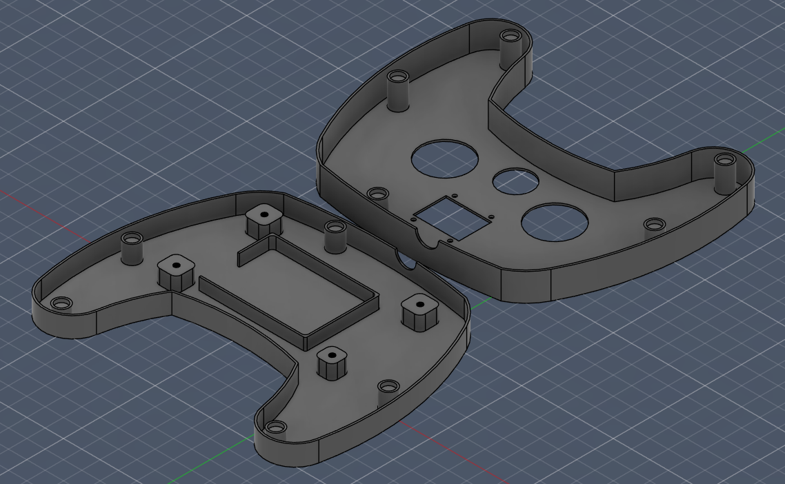

# 3D
A collection of 3D printed features for the no_fly_zone project.

## no_fly_zone_remote_v1_0.f3d
The 3D file for the remote frame. Top frame includes cutouts for joysticks, encoder, and OLED display, and bottom frame adds housing for LiPo and mount for PCB. Five magnet housings on both sides for simple and effective cohesion.

   

### Improvements
- Filet edges for smoother transitions (similar to an Xbox controller)
- Thicker walls for sturdiness