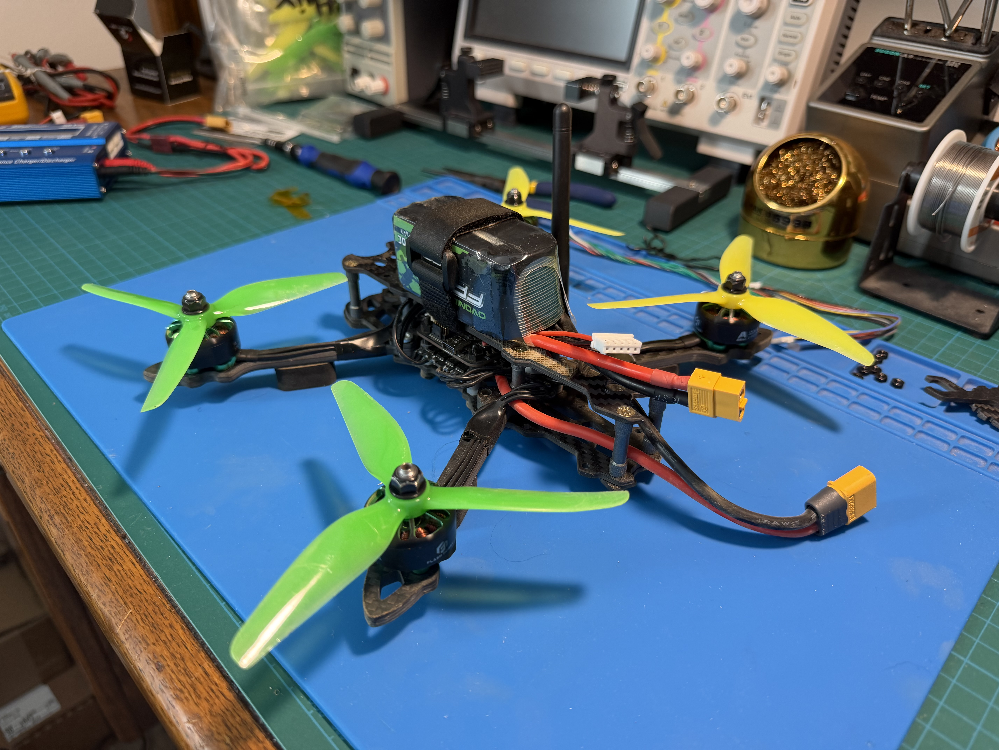
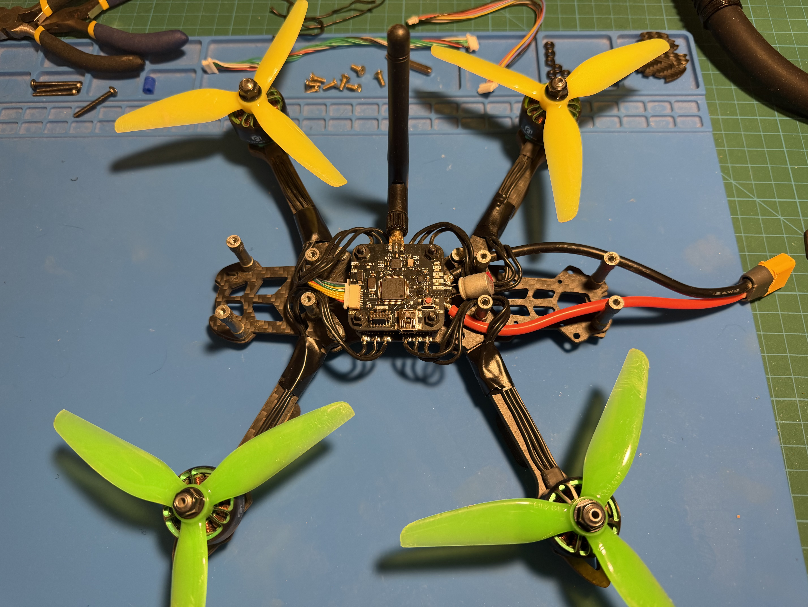
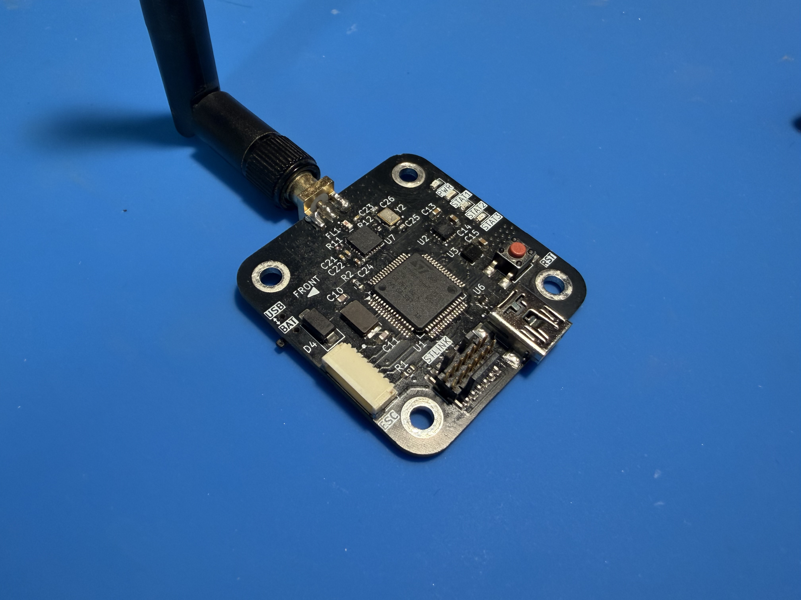
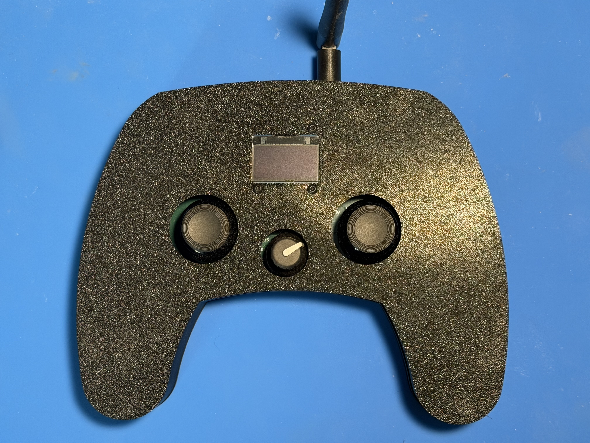
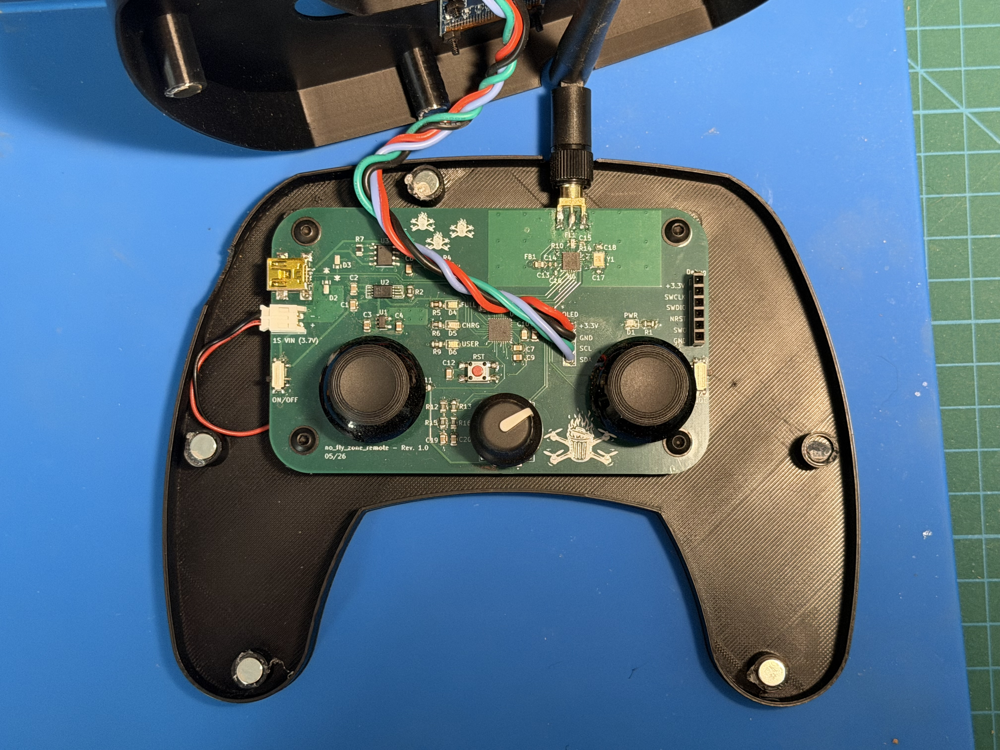

# no_fly_zone
A custom designed quadcopter and remote featuring a custom STM32-based flight controller PCB, STM32-based remote control PCB, sensor fusion, quaternion-based attitude control, wireless communication, and digital ESC communication.

   
  <em>Isometric view of the fully-assembled quadcopter</em>

   
  <em>Top-down view of quadcopter</em>

   
  <em>Custom flight controller PCB</em>

   
  <em>Custom remote control frame</em>

   
  <em>Custom remote control PCB</em>

## Overview
This project focused on the design and implementation of a custom quadcopter flight controller paired with a complementary custom remote from the ground-up. Rather than buying an off-the-shelf flight controller and remote, almost all aspects of both the flight controller and remote were custom made. In summary...

### Custom Features
- Flight controller PCB
- Remote control PCB
- Remote control frame
- Sensor fusion firmware
- Wireless nRF24L01 driver and handler
- Digital ESC communication implementation (DShot)
- Sensor libraries (IMU, Barometer, etc.)
- Encoder and OLED display libraries for remote control

No off-the-shelf software or firmware was used, but some aspects of flight controller design were inspired by PixHawk and betaflight. Components purchased off-shelf include the ESC, four BLDC motors, quadcopter frame, and board components.

## Folder Overview
### /firmware
Contains source code, build settings, documentation, and additional information/diagrams for both the remote and quadcopter. A link to the STM32 submodule library can also be found, where most of the sensor implementation is found.

Note: The scripts subfolder in /firmware contains AI-generated Python scripts for validation and testing purposes. AI was NOT used to generate code found on either the remote or flight controller.

### /hardware
Contains KiCAD schematics and and PCB fabrication outputs for both the remote and quadcopter. Additional information on hardware selection and design can be found in each respective subfolder.

### /3d
Contains the 3D files for the spacers used to separate the STM32 flight controller board and ESC board, along with the 3D files for the remote control housing.

### /screenshots
Contains relevant screenshots for those in other READMEs

## Safety
While this project was a lot of fun to design and build, there were a few safety precautions in place. 
1. Software watchdogs were used in both the remote and quadcopter to monitor internal CPU state, resetting on timeouts.
2. Software timeouts were implemented on the quadcopter to stop all motors if communication with remote failed, or sensor data became stale.
3. In the event of low battery on either the quadcopter or remote, the quadcopter would immediately shut down.
4. Arm/Disarm modes on the remote control preventing inadvertent throttling.