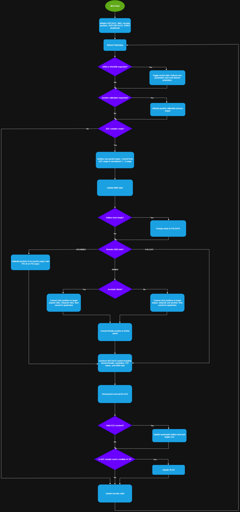
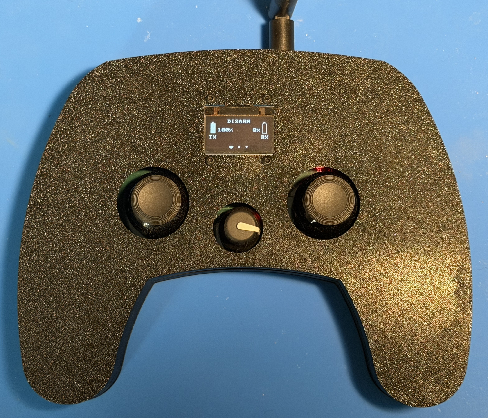
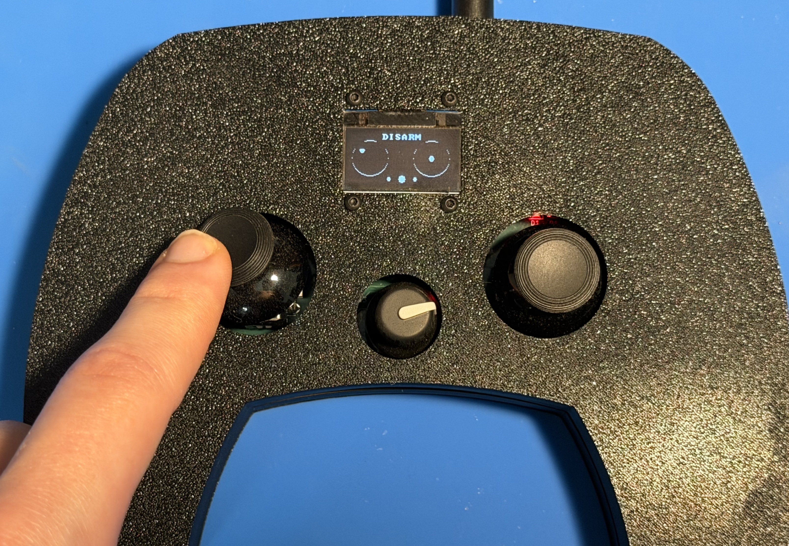
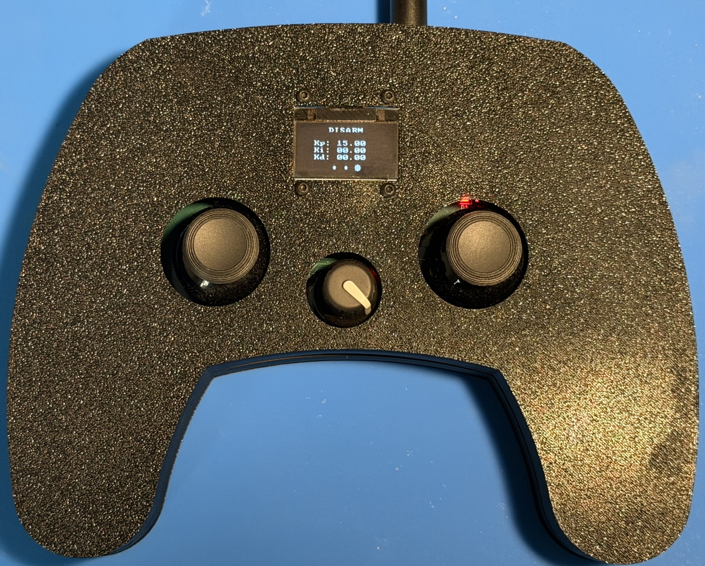

# no_fly_zone_remote
## Overview
The primary purpose of the no_fly_zone_remote is, as one might guess, to remotely control the quadcopter. In order to do this, the remote's job is to establish communication with the quadcopter and transfer relevant telemetry and control data. A complete list of features is detailed below.

### Remote Control Features
- Onboard Battery Management System (BMS) for both charging and monitoring LiPo
- OLED display with three pages of features
- Encoder to navigate between OLED pages
- Wireless communication with quadcopter at 200 Hz
- Joystick calibration and input sanitizing
- ARM/DISARM feature

## Block Diagram

   
  <em>Software flowchart (draw.io)</em>

## Additional Features
### OLED Features
The OLED is navigable using both the joysticks and encoder as inputs. Rotating the encoder results in page turning, and certain combinations of inputs allow for extra features. To ARM/DISARM the quadcopter/remote, the user must be on Page 1 and press the encoder while simultaneously holding the left joystick all of the way down. While in ARM mode, the OLED will not be navigable. In order to move to other pages, the remote must be DISARMED. In order to calibrate the joysticks, navigate to Page 2 and press the encoder switch. For a specified period of time, the CPU will monitor the joysticks and check if the current range can be overwritten. On the last page, the user is able to tune specific PID values used by the quadcopter. To tune, the user must pull the right joystick to the right to move between P, I, and D. Once on the desired setting, moving the right joystick up will raise the values, and moving it down will lower it. The distance from the center will determine how large of an increase/decrease each step is.
 
#### Remote and Quadcopter Battery Level (Page 1)

   
  <em>LiPo battery monitor for remote and quadcopter. Pulling left joystick down and pressing encoder will ARM/DISARM quadcopter</em>

#### Joystick Calibration (Page 2)

   
  <em>Pressing encoder switch allows for user to recalibrate joystick ranges</em>

#### PID Tuning (Page 3)

   
  <em>Using the right joystick, user can modify PID values</em>

### Safety Features
1. Software watchdogs were used to monitor internal CPU state, resetting on timeouts.
2. In the event of low battery on either the quadcopter or remote, the quadcopter would immediately shut down.
3. Arm/Disarm modes on the remote control preventing inadvertent throttling.